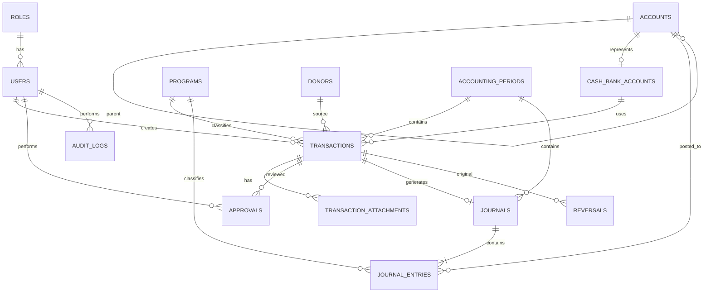

Kita lanjut ke **Development Handoff tahap 1–2: Design Spec + Database Spec**. Saya pertahankan PRD v1.0 sebagai source of truth; spesifikasi ini tidak mengubah requirement produk. Struktur handoff mengikuti standar teknis yang Anda berikan. 

# A. DESIGN SPEC v1.0

**Source:** PRD v1.0
**Platform:** Responsive Web Application
**Status:** Draft for Technical Review

## 1. Design Goals

UI harus membuat pekerjaan akuntansi yang relatif kompleks tetap mudah dipahami oleh Pengelola, tanpa menyembunyikan kontrol akuntansi penting.

Prinsip utama: **jelas, data-first, sedikit dekorasi, status mudah dikenali, angka finansial mudah dibandingkan, dan destructive/irreversible actions sangat eksplisit.**

Navigasi utama desktop:

```text
Logo Yayasan

Dashboard

TRANSAKSI
├── Penerimaan
├── Pengeluaran
└── Jurnal Umum

AKUNTANSI
├── Jurnal
├── Buku Besar
├── Neraca Saldo
└── Periode Akuntansi

APPROVAL                 [Owner]

LAPORAN
├── Posisi Keuangan
├── Penghasilan Komprehensif
├── Perubahan Aset Neto
├── Arus Kas
├── Penerimaan
├── Pengeluaran
└── Program

MASTER DATA
├── Chart of Accounts
├── Program
├── Donatur
└── Kas & Bank

ADMINISTRASI             [Admin]
├── Users
└── Audit Log
```

Menu yang tidak mempunyai permission tidak ditampilkan, tetapi backend tetap menjadi enforcement layer.

---

# 2. Global Application Layout

Desktop menggunakan pola:

```text
┌──────────────────────────────────────────────────────┐
│ Header                         User │ Role │ Logout   │
├───────────────┬──────────────────────────────────────┤
│               │ Breadcrumb                           │
│   Sidebar     │                                      │
│               │ Page Title              Primary CTA  │
│               │──────────────────────────────────────│
│               │ Filter / Summary                     │
│               │                                      │
│               │ Main Content                         │
│               │                                      │
└───────────────┴──────────────────────────────────────┘
```

Tablet menggunakan collapsible sidebar. Mobile menggunakan drawer navigation dan single-column forms.

Financial table tetap mempertahankan alignment angka ke kanan.

---

# 3. Design System Direction

Visual direkomendasikan menggunakan gaya profesional dan sederhana.

Primary color dapat menggunakan hijau tua sebagai identitas sementara yayasan, tetapi warna final merupakan **brand decision**, bukan requirement.

Typography harus mempunyai perbedaan jelas antara page title, section heading, field label, body, helper text dan numeric financial values.

Komponen reusable utama:

`Button`, `Input`, `CurrencyInput`, `DatePicker`, `Select`, `SearchableSelect`, `Textarea`, `FileUpload`, `Badge`, `Card`, `DataTable`, `Pagination`, `Modal`, `ConfirmDialog`, `Toast`, `Alert`, `Tabs`, `Skeleton`, `EmptyState`.

Status menggunakan semantic badge, bukan warna saja.

---

# 4. PG-001 — Login

**Route:** `/login`

Form:

| Field            | Requirement |
| ---------------- | ----------- |
| Email/Username   | Required    |
| Password         | Required    |
| Remember session | Optional    |

Primary CTA: **Masuk**

State yang harus tersedia: loading, invalid credential, inactive account, server error.

Successful login mengarahkan user ke Dashboard.

---

# 5. PG-002 — Dashboard

Dashboard bersifat role-aware.

### Owner

```text
┌─────────────┬─────────────┬─────────────┬─────────────┐
│ Kas & Bank  │ Penerimaan  │ Pengeluaran │ Approval    │
│ Rp xxx      │ Rp xxx      │ Rp xxx      │ 12 pending  │
└─────────────┴─────────────┴─────────────┴─────────────┘

Penerimaan vs Pengeluaran
[Chart]

Penggunaan Dana per Program
[Chart/Table]

Komposisi Aset Neto
[Summary]

Transaksi Menunggu Approval
[Table]
```

### Pengelola

Menonjolkan transaksi Draft, Rejected, Submitted, transaksi terbaru dan tombol **Catat Penerimaan** / **Catat Pengeluaran**.

### Admin

Menonjolkan transaksi Approved menunggu posting, periode aktif, warning akuntansi, dan aktivitas terakhir.

---

# 6. PG-003/004 — Penerimaan

Route:

```text
/transactions/income
/transactions/income/create
/transactions/income/{id}
```

List mempunyai kolom:

`No. Transaksi | Tanggal | Donatur/Sumber | Program | Dana | Nominal | Status | Action`

Filter:

`Tanggal | Status | Program | Pembatasan | Donatur`

Form utama:

| Field               | Type              |   Required   |
| ------------------- | ----------------- | :----------: |
| Tanggal             | Date              |       ✓      |
| Kas/Bank            | Select            |       ✓      |
| Donatur/Sumber Dana | Searchable Select |       —      |
| Donatur Anonim      | Checkbox          |       —      |
| Nominal             | Currency          |       ✓      |
| Klasifikasi Dana    | Select            |       ✓      |
| Program             | Select            |  Conditional |
| Akun Penerimaan     | Select            |       ✓      |
| Keterangan          | Textarea          |       ✓      |
| Bukti               | File              | Policy-based |

Nominal harus `> 0`.

Tanggal tidak boleh berada pada closed period.

---

# 7. PG-005/006 — Pengeluaran

Route:

```text
/transactions/expenses
/transactions/expenses/create
/transactions/expenses/{id}
```

Form:

| Field             | Type     |   Required   |
| ----------------- | -------- | :----------: |
| Tanggal           | Date     |       ✓      |
| Kas/Bank          | Select   |       ✓      |
| Penerima          | Text     |       ✓      |
| Program           | Select   |       ✓      |
| Akun Beban/Tujuan | Select   |       ✓      |
| Nominal           | Currency |       ✓      |
| Keterangan        | Textarea |       ✓      |
| Bukti             | File     | Policy-based |

UI harus menampilkan program dengan jelas agar biaya program dan biaya operasional tidak mudah tertukar.

---

# 8. PG-007/008 — Journal Entry

Jurnal manual menggunakan repeatable rows.

```text
Tanggal     [24/09/2026]
Referensi   [............]
Keterangan  [.................................]

---------------------------------------------------------
Account                  Debit              Kredit
---------------------------------------------------------
Kas                       1.000.000                  -
Pendapatan Donasi                 -          1.000.000
---------------------------------------------------------
TOTAL                     1.000.000          1.000.000
SELISIH                           0
---------------------------------------------------------
```

CTA `Submit` disabled jika:

```text
Total Debit ≠ Total Kredit
```

User dapat menambah/menghapus baris sebelum submit.

Minimum dua journal entries.

---

# 9. PG-009 — Approval Queue

Owner melihat:

`No | Date | Type | Created By | Program | Amount | Age | Action`

Primary filters:

`Pending | Type | Date | Program | Creator`

Klik transaksi membuka detail lengkap, attachment dan journal preview.

Owner mendapatkan:

**Approve**
**Reject**

Reject membuka modal:

```text
Alasan Penolakan *
[                              ]

[Batal] [Tolak Transaksi]
```

Alasan wajib.

---

# 10. PG-010 — Transaction Detail

Halaman ini merupakan pusat lifecycle transaksi.

Header:

```text
TRX-2026-000123                  [SUBMITTED]

Penerimaan Donasi
24 September 2026
```

Sections:

**Informasi transaksi → Classification → Attachment → Journal Preview → Approval History → Audit Timeline.**

Actions ditentukan status dan permission.

Contoh Owner ketika `SUBMITTED`:

```text
[Reject] [Approve]
```

Admin ketika `APPROVED`:

```text
[Post Transaction]
```

Setelah `POSTED`:

```text
Posted • 24 Sep 2026 15:30
Journal: JRN-2026-000123

[View Journal] [Request Reversal]
```

Edit button tidak tersedia.

---

# 11. PG-011 — Buku Besar

Filter:

`Period | Account | Program`

Display:

| Tanggal | Referensi | Keterangan | Debit | Kredit | Saldo |
| ------- | --------- | ---------- | ----: | -----: | ----: |

Saldo dihitung berdasarkan journal entries posted.

User dapat membuka source transaction melalui reference.

---

# 12. PG-012 — Neraca Saldo

| Kode | Akun      |   Debit |  Kredit |
| ---- | --------- | ------: | ------: |
| 1101 | Kas       |     xxx |       — |
| ...  | ...       |     ... |     ... |
|      | **TOTAL** | **xxx** | **xxx** |

UI menampilkan warning bila total debit/kredit tidak balance.

Pada sistem yang sehat kondisi tersebut seharusnya tidak terjadi dan diperlakukan sebagai accounting/system integrity issue.

---

# 13. PG-013 — Financial Reports

Page menggunakan report selector:

```text
[Laporan Posisi Keuangan ▼]

Periode:
[01 Jan 2026] → [31 Dec 2026]

[Generate] [Export]
```

Laporan harus memiliki:

* judul yayasan;
* nama laporan;
* periode;
* generated timestamp;
* nilai finansial;
* export.

Report UI bukan tempat mengubah angka.

---

# 14. PG-015 — Chart of Accounts

Table:

`Code | Account Name | Type | Parent | Active | Action`

Form:

`Code`, `Name`, `Account Type`, `Parent`, `Normal Balance`, `Active`.

Akun yang telah digunakan tidak mempunyai destructive delete.

Gunakan **Deactivate**.

---

# 15. PG-019 — Accounting Period

```text
2026

January      CLOSED
February     CLOSED
...
September    OPEN
October      FUTURE
```

Close Period menggunakan confirmation kuat:

> Penutupan periode akan mencegah transaksi dan perubahan akuntansi pada periode tersebut.

Admin mengajukan → Owner menyetujui → sistem menutup.

Reopen menggunakan workflow serupa dan wajib mencatat alasan.

---

# 16. Responsive & Accessibility

Pada mobile, financial reports dan ledger boleh horizontal-scroll karena memaksa seluruh kolom menjadi cards justru dapat menghilangkan hubungan debit/kredit.

Semua form mempunyai label eksplisit. Error dikaitkan dengan field. Focus state terlihat. Dialog dapat dioperasikan keyboard. Status tidak dibedakan hanya melalui warna.

---

# B. DATABASE SPEC v1.0

Database mengikuti domain dan workflow PRD, bukan sebaliknya. Financial values menggunakan fixed precision sebagaimana diwajibkan standar handoff. 

## 17. Database Architecture

**Database:** MySQL 8+/MariaDB equivalent
**Engine:** InnoDB
**Charset:** `utf8mb4`

Rekomendasi identifier internal: `BIGINT UNSIGNED AUTO_INCREMENT`.

Nomor transaksi bisnis tidak digunakan sebagai primary key.

Financial amount:

```sql
DECIMAL(19,2)
```

Mata uang MVP hanya IDR.

---

# 18. Core Tables

Schema inti:

```text
roles
users

accounts
programs
donors
cash_bank_accounts
accounting_periods

transactions
transaction_attachments

journals
journal_entries

approvals
reversals

audit_logs
```

---

# 19. `roles`

Tujuan: role sistem.

| Column     | Type            | Constraint      |
| ---------- | --------------- | --------------- |
| id         | BIGINT UNSIGNED | PK              |
| code       | VARCHAR(30)     | UNIQUE NOT NULL |
| name       | VARCHAR(100)    | NOT NULL        |
| created_at | TIMESTAMP       |                 |
| updated_at | TIMESTAMP       |                 |

Seed:

```text
ADMIN
MANAGER     → Pengelola
OWNER
```

Nama internal `MANAGER` dapat diganti menjadi `OPERATOR` pada implementation review jika istilah tersebut lebih jelas; UI tetap menggunakan **Pengelola**.

---

# 20. `users`

| Column        | Type            | Constraint      |
| ------------- | --------------- | --------------- |
| id            | BIGINT UNSIGNED | PK              |
| role_id       | BIGINT UNSIGNED | FK              |
| name          | VARCHAR(150)    | NOT NULL        |
| email         | VARCHAR(190)    | UNIQUE NOT NULL |
| password      | VARCHAR(255)    | NOT NULL        |
| status        | VARCHAR(20)     | NOT NULL        |
| last_login_at | TIMESTAMP       | NULL            |
| created_at    | TIMESTAMP       |                 |
| updated_at    | TIMESTAMP       |                 |

Password field hanya menyimpan secure hash.

FK:

```text
users.role_id → roles.id
ON DELETE RESTRICT
```

---

# 21. `accounts`

Chart of Accounts.

| Column         | Type            | Constraint |
| -------------- | --------------- | ---------- |
| id             | BIGINT UNSIGNED | PK         |
| parent_id      | BIGINT UNSIGNED | FK NULL    |
| code           | VARCHAR(30)     | UNIQUE     |
| name           | VARCHAR(150)    | NOT NULL   |
| type           | VARCHAR(30)     | NOT NULL   |
| normal_balance | VARCHAR(10)     | NOT NULL   |
| is_postable    | BOOLEAN         | NOT NULL   |
| is_active      | BOOLEAN         | NOT NULL   |
| created_at     | TIMESTAMP       |            |
| updated_at     | TIMESTAMP       |            |

`normal_balance`:

```text
DEBIT
CREDIT
```

`is_postable=false` memungkinkan akun header/group.

Akun yang sudah memiliki journal entry tidak di-hard-delete.

---

# 22. `programs`

| Column      | Type               |
| ----------- | ------------------ |
| id          | BIGINT UNSIGNED PK |
| code        | VARCHAR(30) UNIQUE |
| name        | VARCHAR(150)       |
| description | TEXT NULL          |
| is_active   | BOOLEAN            |
| created_at  | TIMESTAMP          |
| updated_at  | TIMESTAMP          |

Seed awal:

```text
YATIM
DHUAFA
LANSIA
OPERASIONAL
LAINNYA
```

---

# 23. `donors`

| Column     | Type               |
| ---------- | ------------------ |
| id         | BIGINT UNSIGNED PK |
| name       | VARCHAR(200)       |
| phone      | VARCHAR(30) NULL   |
| email      | VARCHAR(190) NULL  |
| address    | TEXT NULL          |
| notes      | TEXT NULL          |
| is_active  | BOOLEAN            |
| created_at | TIMESTAMP          |
| updated_at | TIMESTAMP          |

Data donor harus diperlakukan sebagai data pribadi dengan akses proporsional.

---

# 24. `cash_bank_accounts`

Entitas ini menghubungkan representasi operasional rekening/kas dengan akun ledger.

| Column         | Type            | Constraint |
| -------------- | --------------- | ---------- |
| id             | BIGINT UNSIGNED | PK         |
| account_id     | BIGINT UNSIGNED | FK UNIQUE  |
| type           | VARCHAR(20)     | NOT NULL   |
| name           | VARCHAR(150)    | NOT NULL   |
| bank_name      | VARCHAR(150)    | NULL       |
| account_number | VARCHAR(100)    | NULL       |
| account_holder | VARCHAR(150)    | NULL       |
| is_active      | BOOLEAN         | NOT NULL   |

`type`:

```text
CASH
BANK
```

Saldo **tidak disimpan sebagai field yang diedit manual**. Saldo berasal dari ledger.

---

# 25. `accounting_periods`

| Column     | Type                 |
| ---------- | -------------------- |
| id         | BIGINT UNSIGNED PK   |
| name       | VARCHAR(100)         |
| start_date | DATE                 |
| end_date   | DATE                 |
| status     | VARCHAR(20)          |
| closed_at  | TIMESTAMP NULL       |
| closed_by  | BIGINT UNSIGNED NULL |
| created_at | TIMESTAMP            |
| updated_at | TIMESTAMP            |

Status:

```text
OPEN
CLOSING_REQUESTED
CLOSED
REOPEN_REQUESTED
```

Constraint/business validation mencegah overlapping period.

---

# 26. `transactions`

Ini merupakan **business transaction header**, bukan ledger.

| Column               | Type                    |
| -------------------- | ----------------------- |
| id                   | BIGINT UNSIGNED PK      |
| transaction_no       | VARCHAR(50) UNIQUE      |
| type                 | VARCHAR(30)             |
| transaction_date     | DATE                    |
| accounting_period_id | BIGINT UNSIGNED FK      |
| program_id           | BIGINT UNSIGNED FK NULL |
| donor_id             | BIGINT UNSIGNED FK NULL |
| cash_bank_account_id | BIGINT UNSIGNED FK NULL |
| counterparty_name    | VARCHAR(200) NULL       |
| restriction_type     | VARCHAR(30) NULL        |
| amount               | DECIMAL(19,2)           |
| description          | TEXT                    |
| status               | VARCHAR(30)             |
| created_by           | BIGINT UNSIGNED FK      |
| submitted_at         | TIMESTAMP NULL          |
| approved_at          | TIMESTAMP NULL          |
| posted_at            | TIMESTAMP NULL          |
| created_at           | TIMESTAMP               |
| updated_at           | TIMESTAMP               |

Types awal:

```text
INCOME
EXPENSE
MANUAL_JOURNAL
ADJUSTMENT
```

Status:

```text
DRAFT
SUBMITTED
REJECTED
APPROVED
POSTED
REVERSED
```

`amount > 0` untuk transaction header yang memiliki amount.

Index:

```text
(transaction_date)
(status)
(type, transaction_date)
(program_id, transaction_date)
(accounting_period_id, status)
(created_by, status)
```

---

# 27. `transaction_attachments`

| Column         | Type               |
| -------------- | ------------------ |
| id             | BIGINT UNSIGNED PK |
| transaction_id | BIGINT UNSIGNED FK |
| original_name  | VARCHAR(255)       |
| storage_path   | VARCHAR(500)       |
| mime_type      | VARCHAR(100)       |
| size_bytes     | BIGINT UNSIGNED    |
| uploaded_by    | BIGINT UNSIGNED FK |
| created_at     | TIMESTAMP          |

File binary tidak disimpan di database.

---

# 28. `journals`

| Column               | Type                    |
| -------------------- | ----------------------- |
| id                   | BIGINT UNSIGNED PK      |
| journal_no           | VARCHAR(50) UNIQUE      |
| transaction_id       | BIGINT UNSIGNED FK NULL |
| journal_date         | DATE                    |
| accounting_period_id | BIGINT UNSIGNED FK      |
| description          | TEXT                    |
| status               | VARCHAR(20)             |
| created_by           | BIGINT UNSIGNED FK      |
| posted_by            | BIGINT UNSIGNED FK NULL |
| posted_at            | TIMESTAMP NULL          |
| created_at           | TIMESTAMP               |
| updated_at           | TIMESTAMP               |

Status:

```text
DRAFT
POSTED
REVERSED
```

Untuk transaksi operasional, `transaction_id` memiliki unique relationship terhadap journal utama.

---

# 29. `journal_entries`

Ini merupakan sumber utama perhitungan ledger.

| Column      | Type                    |
| ----------- | ----------------------- |
| id          | BIGINT UNSIGNED PK      |
| journal_id  | BIGINT UNSIGNED FK      |
| account_id  | BIGINT UNSIGNED FK      |
| program_id  | BIGINT UNSIGNED FK NULL |
| description | VARCHAR(500) NULL       |
| debit       | DECIMAL(19,2)           |
| credit      | DECIMAL(19,2)           |
| created_at  | TIMESTAMP               |

Rule:

```text
debit >= 0
credit >= 0

(debit > 0 AND credit = 0)
OR
(credit > 0 AND debit = 0)
```

Untuk setiap journal:

```text
SUM(debit) = SUM(credit)
```

Balance jurnal harus divalidasi service layer di dalam transaction boundary.

Indexes:

```text
(journal_id)
(account_id)
(account_id, journal_id)
(program_id)
```

---

# 30. Tidak Ada Tabel `ledger_balance`

Pada MVP saya sengaja **tidak membuat mutable balance table**.

Ledger merupakan projection:

```text
POSTED JOURNALS
       ↓
JOURNAL ENTRIES
       ↓
Account Movements
       ↓
Balance / Ledger / Trial Balance
```

Ini menghindari dua source of truth:

```text
journal_entries ≠ balance_table
```

Jika volume data di masa depan menyebabkan masalah performa, materialized summary dapat ditambahkan sebagai derived data, bukan authoritative balance.

---

# 31. `approvals`

| Column         | Type               |
| -------------- | ------------------ |
| id             | BIGINT UNSIGNED PK |
| transaction_id | BIGINT UNSIGNED FK |
| action         | VARCHAR(20)        |
| actor_id       | BIGINT UNSIGNED FK |
| comments       | TEXT NULL          |
| created_at     | TIMESTAMP          |

Action:

```text
APPROVED
REJECTED
```

Riwayat approval tidak ditimpa.

---

# 32. `reversals`

| Column                  | Type                    |
| ----------------------- | ----------------------- |
| id                      | BIGINT UNSIGNED PK      |
| original_transaction_id | BIGINT UNSIGNED FK      |
| reversal_transaction_id | BIGINT UNSIGNED FK NULL |
| reason                  | TEXT                    |
| requested_by            | BIGINT UNSIGNED FK      |
| approved_by             | BIGINT UNSIGNED FK NULL |
| status                  | VARCHAR(30)             |
| requested_at            | TIMESTAMP               |
| approved_at             | TIMESTAMP NULL          |

Status:

```text
REQUESTED
APPROVED
REJECTED
COMPLETED
```

Original transaction tetap tersedia.

---

# 33. `audit_logs`

| Column      | Type                    |
| ----------- | ----------------------- |
| id          | BIGINT UNSIGNED PK      |
| actor_id    | BIGINT UNSIGNED FK NULL |
| action      | VARCHAR(100)            |
| entity_type | VARCHAR(100)            |
| entity_id   | BIGINT UNSIGNED NULL    |
| old_values  | JSON NULL               |
| new_values  | JSON NULL               |
| ip_address  | VARCHAR(45) NULL        |
| user_agent  | VARCHAR(500) NULL       |
| created_at  | TIMESTAMP               |

Password, authentication token, secret dan file contents dilarang masuk `old_values/new_values`.

Audit log bersifat append-oriented.

---

# 34. ERD v1



---

# 35. Critical Transaction Boundary

Posting harus berada dalam satu database transaction.

```text
BEGIN
 │
 ├─ Lock transaction row
 ├─ Verify status = APPROVED
 ├─ Verify accounting period = OPEN
 ├─ Verify not already posted
 ├─ Validate journal entries
 ├─ Verify SUM(debit) = SUM(credit)
 ├─ Create/finalize journal
 ├─ Persist journal entries
 ├─ Mark journal POSTED
 ├─ Mark transaction POSTED
 ├─ Write audit event
 │
COMMIT
```

Jika langkah gagal:

```text
ROLLBACK
```

Unique constraint/status check + row locking digunakan untuk mengurangi risiko double posting.

---

# 36. Historical Integrity

Perubahan nama akun/program tidak boleh mengubah nilai finansial transaksi lama.

FK historis menggunakan `RESTRICT` untuk entitas penting.

Karena itu pola:

```text
DELETE account
```

tidak digunakan setelah account memiliki transaksi.

Gunakan:

```text
is_active = false
```

Hal yang sama berlaku pada program, kas/bank, dan master penting lainnya.

---

# 37. Migration Order

Urutan implementasi:

```text
roles
 ↓
users
 ↓
accounts
 ↓
programs
 ↓
donors
 ↓
cash_bank_accounts
 ↓
accounting_periods
 ↓
transactions
 ↓
transaction_attachments
 ↓
journals
 ↓
journal_entries
 ↓
approvals
 ↓
reversals
 ↓
audit_logs
```

---

# 38. Accounting Integrity Invariants

Ini merupakan aturan yang **tidak boleh dilanggar implementation**:

```text
INV-001
Posted Journal:
SUM(Debit) = SUM(Credit)

INV-002
Posted transaction cannot be edited.

INV-003
Closed period cannot receive financial mutation.

INV-004
Ledger only reads POSTED journals.

INV-005
Financial balance derives from journal entries.

INV-006
Reversal never deletes original journal.

INV-007
Every POSTED operational transaction has a valid journal.

INV-008
Posting must be atomic.

INV-009
Inactive master records remain available for historical references.

INV-010
Frontend permission never replaces backend authorization.
```

---

# 39. Traceability Check

```text
FR-007 Penerimaan
  ↓
PG-004 Form Penerimaan
  ↓
transactions
  ↓
journals
  ↓
journal_entries
  ↓
ledger/report

FR-012 Approval
  ↓
PG-009 Approval Queue
  ↓
approvals
  ↓
transactions.status

FR-013 Posting
  ↓
PG-010 Transaction Detail
  ↓
journals + journal_entries
  ↓
POSTED ledger

FR-018 Reversal
  ↓
PG-010
  ↓
reversals
  ↓
reversal transaction/journal

FR-019 Reporting
  ↓
PG-013
  ↓
posted journal_entries
```

Design dan database sekarang mendukung workflow PRD tanpa memperkenalkan source-of-truth finansial kedua.