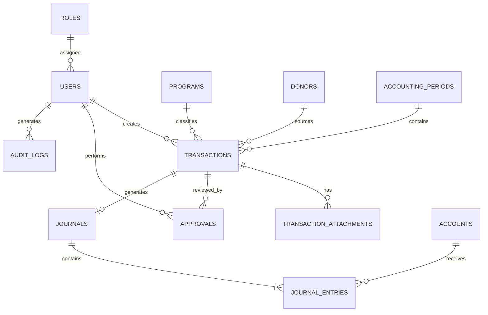

# PRD v1.0 — Sistem Informasi Keuangan Yayasan ISAK 35

PRD ini menjadi **source of truth** produk dan disusun mengikuti struktur, traceability, security, testing, dan quality gate dari `PRD_Master_Standard.md`. 

## 1. Document Information

| Field              | Nilai                                   |
| ------------------ | --------------------------------------- |
| Product            | Sistem Informasi Keuangan Yayasan       |
| Document           | Product Requirements Document           |
| Version            | 1.0                                     |
| Status             | Draft for Review                        |
| Product Type       | Web Application                         |
| Organization       | Yayasan Yatim Piatu, Dhuafa, dan Lansia |
| Organization Model | Single Organization                     |
| Accounting         | Double-entry accounting                 |
| Reporting          | Laporan keuangan berorientasi ISAK 35   |
| Frontend           | React + Vite + Tailwind CSS             |
| Backend            | Laravel REST API                        |
| Database           | MySQL/MariaDB                           |
| Primary Currency   | IDR                                     |
| Timezone           | Asia/Jakarta                            |
| Language           | Bahasa Indonesia                        |
| Last Updated       | 24 September 2026                       |

---

# 2. Executive Summary

Sistem Informasi Keuangan Yayasan adalah aplikasi web untuk mengelola proses keuangan dan akuntansi Yayasan Yatim Piatu, Dhuafa, dan Lansia secara terpusat.

Sistem menggantikan proses pencatatan keuangan yang tersebar atau manual dengan alur terstruktur:

**Penerimaan/Pengeluaran → Approval → Jurnal → Posting → Buku Besar → Neraca Saldo → Penyesuaian → Tutup Periode → Laporan Keuangan.**

Sistem menggunakan prinsip **double-entry accounting**, sehingga setiap jurnal harus seimbang antara debit dan kredit.

Dana dapat diklasifikasikan berdasarkan program dan pembatasannya agar yayasan dapat menelusuri penerimaan dan penggunaan dana untuk Yatim Piatu, Dhuafa, Lansia, operasional, maupun program lainnya.

Tiga role utama adalah:

**Admin** — administrasi sistem dan akuntansi.

**Pengelola** — operasional transaksi keuangan.

**Owner** — monitoring, approval, dan pengawasan.

---

# 3. Background & Problem Statement

Yayasan menerima dan menggunakan dana dari berbagai sumber untuk berbagai tujuan. Tanpa sistem akuntansi terintegrasi, terdapat risiko pencatatan tidak konsisten, sulit menelusuri penggunaan donasi, kesalahan laporan, transaksi tanpa bukti atau approval yang memadai, serta sulit melakukan audit.

**Problem Statement**

> Pengelola yayasan membutuhkan sistem keuangan terintegrasi untuk mencatat, mengendalikan, menelusuri, dan melaporkan aktivitas keuangan yayasan sehingga transaksi dapat dipertanggungjawabkan dan laporan keuangan dapat disusun secara konsisten.

---

# 4. Product Vision

Membangun sistem keuangan yayasan yang menjadi sumber data tunggal untuk transaksi dan pelaporan keuangan, sehingga pengelola dapat melakukan pencatatan dengan efisien sementara Owner memperoleh transparansi dan kontrol terhadap penggunaan dana yayasan.

Sistem harus cukup sederhana untuk operasional yayasan tetapi memiliki fondasi akuntansi, keamanan, dan auditability yang memadai.

---

# 5. Product Goals

| ID    | Goal                                                                 |
| ----- | -------------------------------------------------------------------- |
| G-001 | Memusatkan seluruh transaksi keuangan yayasan dalam satu sistem.     |
| G-002 | Menghasilkan pencatatan double-entry yang konsisten.                 |
| G-003 | Memisahkan dan menelusuri dana berdasarkan pembatasan penggunaannya. |
| G-004 | Mengetahui penerimaan dan penggunaan dana berdasarkan program.       |
| G-005 | Memberikan proses approval terhadap transaksi keuangan.              |
| G-006 | Menghasilkan laporan keuangan secara konsisten dari ledger.          |
| G-007 | Menyediakan audit trail aktivitas keuangan penting.                  |
| G-008 | Mengurangi risiko perubahan transaksi setelah posting.               |
| G-009 | Memberikan Owner dashboard monitoring keuangan.                      |

### Success Metrics

Target numerik bisnis belum diberikan sehingga tidak akan dibuat secara arbitrer.

Indikator awal:

* transaksi posted memiliki jurnal seimbang;
* transaksi posted dapat ditelusuri ke bukti dan pembuatnya;
* transaksi approval dapat ditelusuri ke approver;
* laporan berasal dari ledger yang sama;
* tidak terdapat transaksi pada periode yang telah ditutup;
* penggunaan dana dapat dianalisis berdasarkan program.

---

# 6. Non-Goals

Versi MVP tidak mencakup:

* multi-yayasan;
* multi-currency accounting;
* payroll;
* inventory;
* payment gateway;
* automatic bank feed;
* mobile native application;
* portal donatur;
* fundraising website;
* konsolidasi beberapa badan hukum;
* budgeting kompleks.

---

# 7. Scope

### MUST HAVE

Authentication & authorization, dashboard, user management, Chart of Accounts, program/kegiatan, donatur/sumber dana, kas & bank, penerimaan, pengeluaran, jurnal, approval, posting, buku besar, neraca saldo, jurnal penyesuaian, periode akuntansi, laporan keuangan, upload bukti transaksi, audit trail dan export laporan.

### SHOULD HAVE

Reversal workflow, nomor transaksi otomatis, export PDF/Excel, filter laporan per program, attachment management dan dashboard analytics sederhana.

### COULD HAVE

Import transaksi Excel, recurring transactions, budgeting sederhana dan rekonsiliasi bank semi-otomatis.

### FUTURE

Integrasi bank, payment gateway/donasi online, portal donatur, budgeting & realization, notifikasi eksternal dan aplikasi mobile.

---

# 8. Stakeholders & Personas

### Admin

Bertanggung jawab terhadap konfigurasi sistem, akun pengguna, master data akuntansi, posting, period closing dan koreksi.

Kebutuhan utama: data akuntansi konsisten dan dapat dikontrol.

### Pengelola

Melakukan operasional harian seperti pencatatan penerimaan dan pengeluaran, upload bukti dan pengajuan transaksi.

Kebutuhan utama: input cepat, sederhana, jelas dan mengurangi kesalahan.

### Owner

Mengawasi keuangan yayasan dan memberikan persetujuan terhadap transaksi.

Kebutuhan utama: mengetahui posisi keuangan, penggunaan dana, transaksi yang membutuhkan approval dan laporan periodik.

---

# 9. Roles & Permissions

| Action             | Admin | Pengelola |  Owner  |
| ------------------ | :---: | :-------: | :-----: |
| Dashboard          |   ✓   |     ✓     |    ✓    |
| User management    |   ✓   |     —     |    —    |
| COA management     |   ✓   |    View   |   View  |
| Program management |   ✓   |    View   |   View  |
| Donatur/source     |   ✓   |    CRUD   |   View  |
| Kas & Bank         |   ✓   |     ✓     |   View  |
| Create penerimaan  |   ✓   |     ✓     |    —    |
| Create pengeluaran |   ✓   |     ✓     |    —    |
| Edit Draft         |   ✓   |     ✓*    |    —    |
| Submit             |   ✓   |     ✓     |    —    |
| Approve/Reject     |   —   |     —     |    ✓    |
| Posting            |   ✓   |     —     |    —    |
| Reversal           |   ✓   |     —     | Approve |
| Reports            |   ✓   |     ✓     |    ✓    |
| Export             |   ✓   |     ✓     |    ✓    |
| Close period       |   ✓   |     —     | Approve |
| Audit Log          |   ✓   |     —     |    ✓    |

`*` Pengelola hanya boleh mengubah transaksi yang dibuatnya sendiri dan masih editable.

Semua permission wajib divalidasi kembali oleh backend.

---

# 10. Core Accounting Workflow

```text
Create Transaction
       ↓
     DRAFT
       ↓
    SUBMIT
       ↓
   SUBMITTED
       ↓
Owner Review
   ↙       ↘
REJECT     APPROVE
  ↓           ↓
REJECTED   APPROVED
              ↓
          Admin Posting
              ↓
            POSTED
              ↓
            Ledger
              ↓
         Trial Balance
              ↓
           Reports
```

Status transaksi:

```text
DRAFT → SUBMITTED → APPROVED → POSTED
          ↓
       REJECTED

POSTED → REVERSAL REQUEST → REVERSED
```

`POSTED` bukan status yang dapat dikembalikan menjadi `DRAFT`.

---

# 11. Business Rules

**BR-001 — Balanced Journal**
Total debit wajib sama dengan total kredit sebelum jurnal dapat diposting.

**BR-002 — Posted Transaction Lock**
Transaksi `POSTED` tidak dapat diedit atau dihapus langsung.

**BR-003 — Reversal**
Kesalahan transaksi posted harus diperbaiki melalui transaksi reversal/koreksi yang meninggalkan histori.

**BR-004 — Approval**
Transaksi operasional harus memperoleh approval Owner sebelum posting.

**BR-005 — Separation of Duties**
Pengelola tidak memiliki permission approval atau posting.

**BR-006 — Accounting Period Lock**
Transaksi tidak dapat dibuat, diedit, diposting atau dibalik ke tanggal pada periode `CLOSED`.

**BR-007 — Money Precision**
Nilai finansial menggunakan fixed decimal precision dan tidak menggunakan floating point.

**BR-008 — Auditability**
Create, submit, approval, rejection, posting, reversal dan period closing harus meninggalkan audit trail.

**BR-009 — Posted Ledger**
Laporan resmi hanya memperhitungkan jurnal `POSTED`.

**BR-010 — Program Classification**
Transaksi yang berhubungan dengan program wajib dapat diklasifikasikan ke program terkait.

**BR-011 — Restriction Classification**
Penerimaan harus dapat diklasifikasikan sebagai dengan pembatasan atau tanpa pembatasan bila relevan.

**BR-012 — Closed Period**
Membuka kembali periode merupakan privileged action dan membutuhkan persetujuan Owner.

**BR-013 — Document Number**
Nomor transaksi harus unik berdasarkan aturan penomoran yang ditetapkan sistem.

**BR-014 — Evidence**
Bukti transaksi dapat diwajibkan berdasarkan jenis transaksi/kebijakan yayasan.

---

# 12. Program Structure

Program merupakan master data, bukan nilai yang di-hardcode.

Initial reference data:

```text
Yatim Piatu
Dhuafa
Lansia
Operasional Yayasan
Program Lainnya
```

Admin dapat menambah atau menonaktifkan program.

Program yang sudah digunakan transaksi tidak boleh hard-delete.

---

# 13. Chart of Accounts

COA harus configurable.

Hierarki konseptual:

```text
Aset
├── Kas
├── Bank
├── Piutang
└── Aset lainnya

Liabilitas
├── Utang
└── Liabilitas lainnya

Aset Neto
├── Tanpa Pembatasan
└── Dengan Pembatasan

Pendapatan/Penerimaan
├── Donasi
├── Sumbangan
└── Penerimaan lainnya

Beban
├── Program Yatim
├── Program Dhuafa
├── Program Lansia
├── Operasional
└── Beban lainnya
```

Daftar akun final merupakan keputusan kebijakan akuntansi yayasan dan harus dapat dikonfigurasi.

---

# 14. Functional Requirements

### FR-001 — Authentication

Sistem harus memungkinkan user aktif login menggunakan credential valid.

Backend wajib memverifikasi credential dan status akun.

### FR-002 — User Management

Admin harus dapat membuat, mengubah, mengaktifkan dan menonaktifkan user serta menentukan role.

### FR-003 — Chart of Accounts

Admin harus dapat mengelola akun, kode akun, nama, kategori, parent account dan status aktif.

Akun yang telah memiliki transaksi tidak dapat dihapus secara destruktif.

### FR-004 — Program

Admin harus dapat mengelola master program.

### FR-005 — Donatur/Sumber Dana

Admin dan Pengelola harus dapat mencatat informasi sumber dana/donatur.

Donatur dapat bersifat opsional untuk penerimaan anonim.

### FR-006 — Kas & Bank

Sistem harus mendukung beberapa akun kas/bank dan mutasinya berasal dari jurnal.

### FR-007 — Penerimaan

Admin/Pengelola harus dapat mencatat penerimaan dengan minimal:

* tanggal;
* kas/bank;
* sumber/donatur;
* nominal;
* klasifikasi dana;
* program jika relevan;
* akun;
* keterangan;
* bukti.

### FR-008 — Pengeluaran

Admin/Pengelola harus dapat mencatat pengeluaran dengan minimal:

* tanggal;
* kas/bank;
* penerima;
* akun beban/tujuan;
* nominal;
* program;
* keterangan;
* bukti.

### FR-009 — Journal Generation

Sistem harus membentuk jurnal double-entry dari transaksi operasional berdasarkan mapping akun.

### FR-010 — Manual Journal

Admin/Pengelola yang memiliki permission harus dapat membuat jurnal umum/penyesuaian dengan beberapa baris debit/kredit.

Jurnal tidak dapat disubmit jika tidak seimbang.

### FR-011 — Submit

Draft dapat dikirim untuk approval.

### FR-012 — Approval

Owner harus dapat melihat detail transaksi dan memilih `Approve` atau `Reject`.

Reject wajib memiliki alasan.

### FR-013 — Posting

Admin dapat memposting transaksi approved.

Posting harus atomic.

### FR-014 — Ledger

Sistem harus menghasilkan buku besar berdasarkan jurnal posted.

### FR-015 — Trial Balance

Sistem harus menghasilkan neraca saldo berdasarkan periode.

### FR-016 — Accounting Period

Admin harus dapat membuat periode akuntansi serta mengajukan penutupan periode.

### FR-017 — Period Closing

Periode hanya dapat ditutup setelah validasi dan approval sesuai workflow.

### FR-018 — Reversal

Admin dapat mengajukan reversal atas transaksi posted dengan alasan wajib.

### FR-019 — Financial Reporting

Sistem harus menyediakan laporan keuangan berdasarkan data ledger.

### FR-020 — Operational Reporting

Sistem harus menyediakan laporan transaksi berdasarkan periode, program, akun, dan sumber dana yang relevan.

### FR-021 — Attachment

Transaksi harus mendukung attachment bukti.

### FR-022 — Audit Trail

Sistem harus mencatat aktivitas sensitif beserta actor, waktu, action, entity dan identifier.

### FR-023 — Dashboard

Sistem harus menampilkan dashboard sesuai kebutuhan role.

### FR-024 — Export

User dengan permission harus dapat mengekspor laporan.

### FR-025 — Search & Filter

Daftar transaksi harus mendukung search, filtering, sorting dan pagination server-side.

---

# 15. Main Acceptance Criteria

### AC-001 — Balanced Journal

**Given** jurnal memiliki total debit Rp1.000.000 dan kredit Rp900.000
**When** user mencoba submit/post
**Then** sistem menolak transaksi dan menampilkan ketidakseimbangan Rp100.000.

### AC-002 — Approval

**Given** transaksi berstatus `SUBMITTED`
**When** Owner melakukan approval
**Then** status menjadi `APPROVED`, actor dan timestamp tercatat.

### AC-003 — Unauthorized Approval

**Given** Pengelola login
**When** mencoba mengakses endpoint approval
**Then** backend mengembalikan `403 Forbidden`.

### AC-004 — Posted Lock

**Given** transaksi telah `POSTED`
**When** user mencoba mengubah nominal
**Then** sistem menolak perubahan.

### AC-005 — Closed Period

**Given** September 2026 berstatus `CLOSED`
**When** user membuat transaksi bertanggal September 2026
**Then** sistem menolak transaksi.

### AC-006 — Posting

**Given** transaksi valid dan `APPROVED`
**When** Admin melakukan posting
**Then** transaksi, jurnal dan ledger effect tersimpan secara atomic atau seluruh proses rollback jika gagal.

### AC-007 — Reversal

**Given** transaksi telah posted
**When** reversal disetujui dan diproses
**Then** sistem membuat jurnal pembalik dan mempertahankan transaksi asli.

---

# 16. Information Architecture

```text
Application
│
├── Dashboard
│
├── Transaksi
│   ├── Penerimaan
│   ├── Pengeluaran
│   └── Jurnal Umum
│
├── Approval
│
├── Akuntansi
│   ├── Jurnal
│   ├── Buku Besar
│   ├── Neraca Saldo
│   ├── Penyesuaian
│   └── Periode Akuntansi
│
├── Laporan
│   ├── Laporan Keuangan
│   ├── Penerimaan
│   ├── Pengeluaran
│   ├── Program
│   └── Kas & Bank
│
├── Master Data
│   ├── Chart of Accounts
│   ├── Program
│   ├── Donatur / Sumber Dana
│   └── Kas & Bank
│
├── Audit Log
│
└── Administration
    ├── Users
    └── Settings
```

Navigation disaring berdasarkan role.

---

# 17. Screen Inventory

| ID     | Screen             | Role              |
| ------ | ------------------ | ----------------- |
| PG-001 | Login              | Semua             |
| PG-002 | Dashboard          | Semua             |
| PG-003 | Penerimaan         | Admin, Pengelola  |
| PG-004 | Form Penerimaan    | Admin, Pengelola  |
| PG-005 | Pengeluaran        | Admin, Pengelola  |
| PG-006 | Form Pengeluaran   | Admin, Pengelola  |
| PG-007 | Jurnal             | Admin, Pengelola  |
| PG-008 | Journal Entry      | Admin, Pengelola  |
| PG-009 | Approval Queue     | Owner             |
| PG-010 | Transaction Detail | Sesuai permission |
| PG-011 | Buku Besar         | Semua             |
| PG-012 | Neraca Saldo       | Semua             |
| PG-013 | Laporan Keuangan   | Semua             |
| PG-014 | Laporan Program    | Semua             |
| PG-015 | COA                | Admin/View others |
| PG-016 | Program            | Admin/View others |
| PG-017 | Donatur            | Admin, Pengelola  |
| PG-018 | Kas & Bank         | Sesuai permission |
| PG-019 | Periode Akuntansi  | Admin, Owner      |
| PG-020 | Users              | Admin             |
| PG-021 | Audit Log          | Admin, Owner      |

---

# 18. UI/UX Requirements

Aplikasi menggunakan dashboard layout dengan sidebar pada desktop.

Status transaksi menggunakan badge yang konsisten:

`DRAFT`, `SUBMITTED`, `REJECTED`, `APPROVED`, `POSTED`, `REVERSED`.

Aksi destructive/reversal/closing harus menggunakan confirmation dialog.

Form transaksi harus menampilkan validasi pada field terkait, bukan hanya generic error.

Setiap halaman data harus mempunyai:

**Loading → Empty → Loaded → Error states.**

### Desktop

Sidebar permanen, table penuh, filter horizontal dan form dapat menggunakan beberapa kolom.

### Tablet

Sidebar collapsible, form menyesuaikan 1–2 kolom.

### Mobile

Navigation menggunakan drawer. Form menjadi single column. Tabel finansial yang tidak dapat disederhanakan menggunakan controlled horizontal scrolling atau prioritized columns.

Nominal harus mudah dibaca dan konsisten menggunakan format Rupiah.

---

# 19. Dashboard

### Owner

Prioritas informasi:

* saldo kas/bank;
* penerimaan periode berjalan;
* pengeluaran periode berjalan;
* transaksi menunggu approval;
* penggunaan dana per program;
* komposisi dana;
* ringkasan tren penerimaan/pengeluaran.

### Pengelola

Prioritas:

* transaksi Draft;
* transaksi Rejected;
* transaksi Submitted;
* transaksi terbaru;
* shortcut penerimaan;
* shortcut pengeluaran.

### Admin

Prioritas:

* transaksi menunggu posting;
* periode akuntansi;
* jurnal tidak lengkap/bermasalah;
* status sistem/master data;
* ringkasan keuangan.

---

# 20. Reporting Requirements

Sistem akan mendukung kelompok laporan:

### Financial Statements

* Laporan Posisi Keuangan;
* Laporan Penghasilan Komprehensif;
* Laporan Perubahan Aset Neto;
* Laporan Arus Kas;
* data pendukung Catatan atas Laporan Keuangan.

### Accounting Reports

* Jurnal Umum;
* Buku Besar;
* Neraca Saldo.

### Management Reports

* Penerimaan;
* Pengeluaran;
* Kas & Bank;
* aktivitas per program;
* sumber dana/donatur;
* dana dengan/tanpa pembatasan.

Filter utama:

`period`, `date range`, `account`, `program`, `fund restriction`, dan filter lain sesuai jenis laporan.

> Catatan produk: PRD menetapkan kemampuan sistem dan struktur reporting. Mapping akun final serta kebijakan penyajian laporan tetap harus divalidasi oleh pihak yang bertanggung jawab atas kebijakan akuntansi yayasan sebelum production.

---

# 21. System Architecture

```text
┌──────────────────────┐
│ React Web Application│
│ Vite + Tailwind      │
└──────────┬───────────┘
           │
       HTTPS / JSON
           │
┌──────────▼───────────┐
│ Laravel REST API     │
│                      │
│ Controllers          │
│ Validation           │
│ Authorization        │
│ Services             │
│ Accounting Domain    │
└──────────┬───────────┘
           │
      DB Transaction
           │
┌──────────▼───────────┐
│ MySQL / MariaDB      │
└──────────────────────┘
```

Arsitektur berupa **modular monolith**, bukan microservices.

Accounting/posting logic tidak ditempatkan di React.

---

# 22. Core Domain Model

Entitas utama yang dibutuhkan:

```text
User
Role
Account
Program
Donor
Cash/Bank Account
Accounting Period

Transaction
Transaction Attachment

Journal
Journal Entry

Approval
Reversal

Audit Log
```

Satu transaksi dapat menghasilkan satu jurnal yang mempunyai dua atau lebih journal entries.

---

# 23. Preliminary ERD



ERD ini masih level PRD. Detail column, FK policy, index, precision dan migration akan difinalisasi pada **Database Spec**, bukan ditebak terlalu dini.

---

# 24. API Requirement Overview

API menggunakan prefix:

```text
/api/v1
```

Contoh endpoint domain:

```text
POST   /auth/login
POST   /auth/logout

GET    /transactions
POST   /transactions
GET    /transactions/{id}
PUT    /transactions/{id}

POST   /transactions/{id}/submit
POST   /transactions/{id}/approve
POST   /transactions/{id}/reject
POST   /transactions/{id}/post
POST   /transactions/{id}/reversal-request

GET    /accounts
GET    /programs
GET    /donors

GET    /journals
GET    /ledger
GET    /trial-balance

GET    /reports/financial-position
GET    /reports/comprehensive-income
GET    /reports/net-assets
GET    /reports/cash-flow
```

Action seperti approval dan posting sengaja menggunakan command endpoint, bukan dipaksakan menjadi CRUD biasa.

API contract final akan diturunkan setelah database dan workflow final sesuai Development Handoff Standard. 

---

# 25. Transaction Integrity

Posting merupakan operasi kritis dan harus menggunakan database transaction.

Secara konseptual:

```text
BEGIN

Validate transaction
↓
Validate period
↓
Validate approval
↓
Validate Debit = Credit
↓
Create/finalize journal
↓
Create journal entries
↓
Set transaction POSTED
↓
Write audit event

COMMIT
```

Jika satu operasi gagal:

```text
ROLLBACK
```

Tidak boleh terjadi kondisi transaksi berstatus posted tetapi journal entries hanya tersimpan sebagian.

---

# 26. Authentication & Security

### NFR-SEC-001

Password harus menggunakan password hashing Laravel yang aman. Plaintext password dilarang.

### NFR-SEC-002

Semua authorization harus diterapkan server-side.

### NFR-SEC-003

Object-level authorization harus mencegah Pengelola memodifikasi transaksi milik user lain apabila policy membatasinya.

### NFR-SEC-004

Database access menggunakan ORM/query binding aman terhadap SQL injection.

### NFR-SEC-005

Output/input harus ditangani untuk mengurangi risiko XSS.

### NFR-SEC-006

Production wajib menggunakan HTTPS.

### NFR-SEC-007

Credential database dan application secret hanya berada di server environment.

### NFR-SEC-008

Endpoint authentication harus memiliki perlindungan yang wajar terhadap repeated login attempts.

### NFR-SEC-009

Production error tidak boleh mengekspos stack trace atau database credential.

---

# 27. File Security

Bukti transaksi diperlakukan sebagai file private.

Allowed awal:

```text
PDF
JPG/JPEG
PNG
```

Sistem harus melakukan:

* MIME validation;
* extension validation;
* size limitation;
* random/safe filename;
* authorization saat download;
* penyimpanan non-executable.

Batas ukuran final ditentukan pada technical specification.

---

# 28. Audit Log

Minimal mencatat:

```text
Actor
Timestamp
Action
Module
Entity
Entity ID
Relevant status change
IP/context jika diperlukan
```

Contoh:

```text
TRANSACTION_CREATED
TRANSACTION_UPDATED
TRANSACTION_SUBMITTED
TRANSACTION_APPROVED
TRANSACTION_REJECTED
TRANSACTION_POSTED
REVERSAL_REQUESTED
TRANSACTION_REVERSED
PERIOD_CLOSED
PERIOD_REOPENED
USER_ROLE_CHANGED
```

Audit log tidak boleh menyimpan password, session secret atau token.

---

# 29. Reliability & Data Integrity

### NFR-001

Financial mutation yang terdiri dari beberapa write wajib atomic.

### NFR-002

Database harus menggunakan PK/FK dan constraints yang sesuai.

### NFR-003

Financial values menggunakan `DECIMAL` dengan precision yang akan ditetapkan pada Database Spec.

### NFR-004

Double submission pada aksi kritis seperti posting harus dicegah.

### NFR-005

Data transaksi historis tidak boleh hilang karena perubahan master data.

### NFR-006

Dataset besar menggunakan server-side pagination/filtering.

### NFR-007

Semua tanggal transaksi menggunakan aturan timezone aplikasi yang konsisten.

---

# 30. Backup & Recovery

Karena sistem menangani data keuangan, database production wajib memiliki automated backup.

Backup harus mencakup:

* database;
* attachment/bukti transaksi;
* konfigurasi penting yang dibutuhkan untuk recovery.

Kebijakan retention final mengikuti kapasitas hosting dan kebutuhan yayasan.

Restore test harus dilakukan secara berkala; keberadaan file backup saja tidak dianggap cukup sebagai recovery strategy.

---

# 31. Environments & Deployment

Minimal:

```text
Development
     ↓
Staging
     ↓
Production
```

Production:

```text
HTTPS
├── React production build
├── Laravel API
├── MySQL/MariaDB
├── Private file storage
├── Environment secrets
├── Application/error logs
└── Automated backup
```

Staging digunakan untuk QA/UAT sebelum release production.

---

# 32. Testing Strategy

Testing tidak hanya dilakukan pada UI.

### Functional

Login, transaksi, approval, posting, reversal, reporting.

### Accounting

* debit = kredit;
* ledger;
* account balances;
* trial balance;
* period filtering;
* reversal.

### Validation

Nominal invalid, tanggal invalid, missing account, missing program dan invalid attachment.

### Authorization

Setiap role diuji terhadap endpoint yang diperbolehkan dan dilarang.

### Workflow

```text
Draft
→ Submit
→ Approve
→ Post
→ Ledger
→ Report
```

dan:

```text
Draft
→ Submit
→ Reject
→ Correction
→ Resubmit
```

### Security

Authentication, object authorization, SQL injection protection, XSS, upload security dan secret exposure.

### Responsive

Desktop, tablet dan mobile.

### Regression

Workflow accounting utama wajib diuji ulang setelah perubahan pada transaksi, posting atau reporting.

---

# 33. Example Traceability

| FR     | Screen | API                | Domain/Data     | Acceptance/Test       |
| ------ | ------ | ------------------ | --------------- | --------------------- |
| FR-007 | PG-004 | Create Transaction | Transaction     | AC transaction        |
| FR-011 | PG-010 | Submit             | Transaction     | Submit test           |
| FR-012 | PG-009 | Approve/Reject     | Approval        | AC-002/003            |
| FR-013 | PG-010 | Post               | Journal/Entries | AC-006                |
| FR-014 | PG-011 | Ledger             | Journal Entries | Ledger test           |
| FR-015 | PG-012 | Trial Balance      | Journal Entries | Balance test          |
| FR-018 | PG-010 | Reversal           | Journal         | AC-007                |
| FR-019 | PG-013 | Reports            | Ledger          | Report reconciliation |

Full traceability matrix akan dilengkapi pada Development Handoff.

---

# 34. MVP Definition

MVP dianggap usable ketika yayasan dapat melakukan satu siklus penuh:

```text
Setup COA
     ↓
Setup Program
     ↓
Create User
     ↓
Record Income/Expense
     ↓
Submit
     ↓
Owner Approval
     ↓
Posting
     ↓
Journal
     ↓
Ledger
     ↓
Trial Balance
     ↓
Financial Reports
     ↓
Period Closing
```

Security, audit trail, validation dan backup **bukan Future Feature**.

---

# 35. Development Roadmap

**Phase 0 — Product & Accounting Validation**

Finalisasi PRD, workflow, kebijakan akun dan mapping laporan.

**Phase 1 — Foundation**

Repository, Laravel/React foundation, environments, design system dan database baseline.

**Phase 2 — Authentication & Authorization**

Login, users, roles, permissions dan protected routes.

**Phase 3 — Accounting Master Data**

COA, program, kas/bank, donor dan accounting periods.

**Phase 4 — Transaction Vertical Slice**

Penerimaan dan pengeluaran dibangun end-to-end: DB → API → validation → UI → permission → test.

**Phase 5 — Approval & Accounting Engine**

Approval, journal generation, posting, journal entries, locking dan reversal.

**Phase 6 — Ledger & Reporting**

Buku besar, neraca saldo dan financial reporting.

**Phase 7 — Controls**

Period closing, audit trail, attachment security dan export.

**Phase 8 — QA & Hardening**

Accounting reconciliation, permission testing, responsive testing, security dan regression.

**Phase 9 — Deployment & UAT**

Staging → UAT → backup/restore verification → production.

---

# 36. Risks & Mitigation

| Risiko                            | Impact | Mitigasi                                 |
| --------------------------------- | ------ | ---------------------------------------- |
| Mapping akun salah                | Tinggi | Validasi COA dengan pihak akuntansi      |
| Laporan tidak reconcile           | Tinggi | Semua laporan berasal dari posted ledger |
| Transaksi berubah setelah posting | Tinggi | Lock + reversal                          |
| Pengelola mendapat akses berlebih | Tinggi | Backend RBAC                             |
| Duplicate posting                 | Tinggi | Transaction + concurrency protection     |
| Kehilangan data                   | Tinggi | Backup + restore testing                 |
| Bukti transaksi bocor             | Tinggi | Private storage + authorization          |
| Scope berkembang menjadi ERP      | Sedang | Pertahankan MVP boundary                 |

---

# 37. Assumptions

**A-001** Sistem digunakan oleh satu badan yayasan.

**A-002** IDR merupakan mata uang pencatatan utama.

**A-003** Bahasa antarmuka adalah Bahasa Indonesia.

**A-004** Timezone operasional Asia/Jakarta.

**A-005** Yayasan mempunyai program Yatim Piatu, Dhuafa, Lansia dan kegiatan operasional.

**A-006** Tidak ada bank integration/payment gateway pada MVP.

**A-007** Donatur anonim diperbolehkan.

**A-008** Program dan COA configurable.

**A-009** Owner merupakan pihak yang memiliki kewenangan approval pada workflow aplikasi.

**A-010** Laporan hanya menggunakan jurnal posted.

**A-011** Deployment awal menggunakan arsitektur modular monolith.

---

# 38. Open Questions Sebelum Production

PRD sudah cukup untuk dilanjutkan ke desain teknis, tetapi beberapa keputusan harus dikonfirmasi sebelum production:

1. Chart of Accounts final dan opening balance.
2. Mapping COA ke setiap laporan keuangan.
3. Kebijakan nominal transaksi yang wajib memiliki attachment.
4. Kebijakan approval jika Owner berhalangan.
5. Format nomor bukti/transaksi yayasan.
6. Tahun buku dan aturan closing.
7. Kebijakan retention dokumen/bukti transaksi.

Poin-poin ini tidak menghalangi pembangunan foundation, tetapi **mapping akuntansi final harus selesai sebelum reporting dinyatakan production-ready**.

---

# 39. Definition of Done

MVP dinyatakan selesai jika semua Must Have telah diimplementasikan dan:

* workflow transaksi berjalan end-to-end;
* debit/kredit selalu tervalidasi;
* role/permission diuji;
* approval bekerja;
* posting atomic;
* posted transaction terkunci;
* reversal dapat diaudit;
* closed period terlindungi;
* ledger dan trial balance reconcile;
* laporan berasal dari posted ledger;
* attachment terlindungi;
* audit trail tersedia;
* responsive behavior diuji;
* security baseline diterapkan;
* backup dan restore diverifikasi;
* UAT disetujui stakeholder;
* tidak terdapat critical/high-severity defect yang belum ditangani.

---

# 40. Final Quality Check

**Problem → Goal:** ✓
**Goal → Workflow:** ✓
**Role → Permission:** ✓
**Workflow → Requirement:** ✓
**Requirement → UI:** ✓
**UI → API:** ✓ preliminary
**API → Domain/Database:** ✓ preliminary
**Financial integrity:** ✓
**Approval & segregation of duties:** ✓
**Posted transaction protection:** ✓
**Period control:** ✓
**Security baseline:** ✓
**Auditability:** ✓
**Responsive states:** ✓
**MVP end-to-end:** ✓
**Testing strategy:** ✓
**Deployment strategy:** ✓

